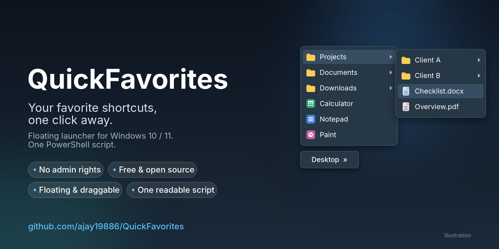
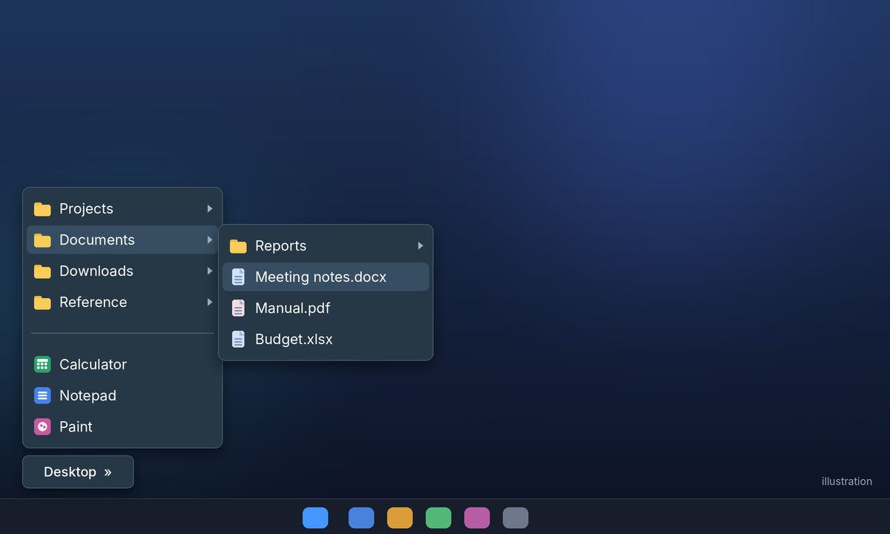
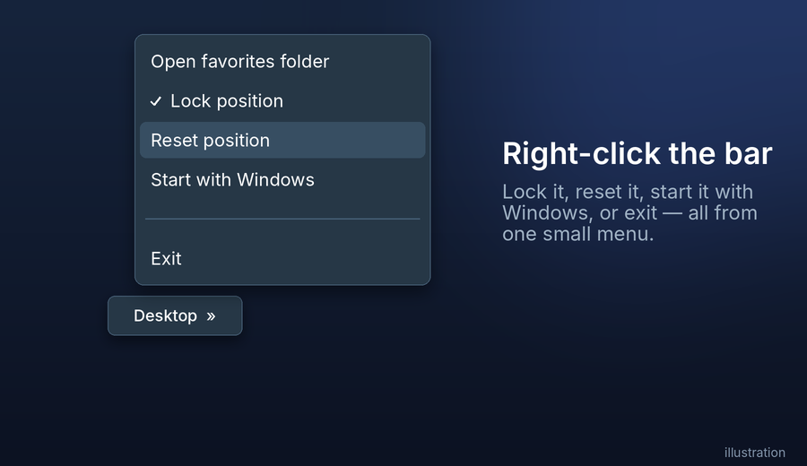

<p align="center">
  
</p>

<p align="center">
  
  
  
  
</p>

# QuickFavorites

**Bring your favorite shortcuts back to Windows 11 - one click, no admin rights.**

Windows 11 removed the classic taskbar toolbars. QuickFavorites puts a small, draggable **Desktop »** button on your screen. Click it and a cascading menu of your favorite folders, files, apps and shortcuts opens - built from one ordinary folder you control.

The core is a single, readable PowerShell script. Run it on its own, or use the optional one-click installer.

## Why you might like it

- **No administrator rights.** Runs in your normal user session. It never asks for UAC elevation.
- **No installer required.** The single `.ps1` file runs on its own (an optional one-click installer is included). There is no background service - exit it from its right-click menu and it is gone.
- **Floating and draggable.** Put it wherever you like, lock it in place, and it remembers the position.
- **Your folder is the menu.** Drop a shortcut in, and it appears. Sub-folders become cascading menus, with real Windows icons.
- **Readable and auditable.** No compiled binary - you can read every line before you run it.
- **Considerate.** Hides itself during full-screen apps and presentations, tries to stay on-screen after monitor changes, and never starts twice.

## Screenshots

> The images below are **illustrations** of the interface. Real screenshots are welcome - see [Contributing](#contributing).

<p align="center">
  
</p>

<p align="center">
  
</p>

## Quick start

**Easiest - the installer (no admin rights needed):**

1. Download the latest ZIP from the [Releases page](../../releases) (or **Code > Download ZIP**).
2. Right-click the ZIP, choose **Properties**, tick **Unblock** if you see it, click OK - *then* extract it (it creates a folder named `QuickFavorites`).
3. Double-click **`Install.bat`** and answer a few yes/no questions (just press **Enter** for Yes):
   - create a **sample favorites menu** (folders, Notepad, Calculator, sample documents and web links) so you can try it immediately
   - create a **desktop shortcut**
   - start with Windows
4. The **Desktop »** button appears just above the taskbar. Click it.
5. Right-click the button, choose **Open favorites folder**, and replace the samples with your own shortcuts.

The installer copies the program to `%USERPROFILE%\QuickFavorites\`, so Start-with-Windows keeps working even if you delete the download. Re-run `Install.bat` any time to **update** - your own favorites and settings are never overwritten.

To start it again after you choose **Exit**, use the desktop shortcut or double-click `Start-QuickFavorites.bat`.

<details>
<summary>Manual install (no installer)</summary>

1. Download `FavoritesMenu.ps1` and `Start-QuickFavorites.bat` into the same folder and unblock both (right-click > Properties > Unblock).
2. Double-click `Start-QuickFavorites.bat`.

Or press **Win + R**, paste this, and press Enter. Add `-Detached` at the end to run in the current console and see warnings while troubleshooting:

```
powershell.exe -NoProfile -ExecutionPolicy Bypass -WindowStyle Hidden -STA -File "%USERPROFILE%\QuickFavorites\FavoritesMenu.ps1"
```

</details>

The script starts itself in a separate hidden process, so closing any window you launched it from does not close the bar.

`-ExecutionPolicy Bypass` applies to that one PowerShell process only. It does not change your machine's policy and does not grant admin rights.

> **Managed work PC?** Group Policy, AppLocker or similar rules may still block scripts, even without admin rights. Follow your organization's IT policy.

## Features

| Feature | Details |
| --- | --- |
| One-click installer | `Install.bat` installs or updates for the current user, with an optional sample menu, desktop shortcut and autostart |
| Folder-driven menu | Shortcuts, files, apps and folders from `%USERPROFILE%\QuickFavorites\Menu` |
| Windows icons | The same icons Explorer shows, cached for speed |
| Lazy sub-menus | Sub-folders load when opened, so big or looping folder trees stay fast |
| Draggable and lockable | Drag threshold prevents accidental moves; position saved per user |
| Monitor and DPI handling | Keeps the bar on a visible screen after monitor changes (best-effort; docking and undocking have had limited testing). System-level DPI awareness |
| Open folders directly | Double-click or right-click a folder in the menu to open it in Explorer |
| Right-click options | Open folder, Lock position, Reset position, Start with Windows, Exit |
| Full-screen friendly | Hides during full-screen apps and presentations (best-effort detection) |
| Single instance | Starting it twice does not stack two bars |
| Dark theme | Dropdowns, arrows and check marks match the bar |
| Visible errors | A folder that cannot be opened shows a greyed "(can't open this folder)" item |
| Startup check | Detects an existing Startup-folder shortcut so it never launches twice |

## How it compares

Several free projects solve the same Windows 11 gap in different ways. Pick whichever fits your workflow.

| Project | Approach |
| --- | --- |
| **QuickFavorites** (this project) | A floating, always-on-top button on the desktop; one readable PowerShell script |
| [TrayToolbar](https://github.com/brondavies/TrayToolbar) | Tray-icon menu built from a folder of shortcuts |
| [TaskFolder](https://github.com/rod-trent/TaskFolder) | System-tray launcher menu |
| [WinPinMenu](https://github.com/hatelamers/winpinmenu) | Pins a folder as a popup menu from the taskbar |
| [ExplorerPatcher](https://github.com/valinet/ExplorerPatcher) | Restores the Windows 10 taskbar, including its toolbars |

QuickFavorites' angle: you can *see* it on your desktop, move it where you want, and read the whole source in one file. Check each project's own page for its requirements.

## Using it

- **Left-click** the button to open your favorites.
- **Drag** the button to move it. Use **Lock position** to stop accidental moves.
- **Right-click** the button for options.
- **Open a folder instead of drilling down:** double-click or right-click a folder in the menu to open it in Explorer.
- Organize favorites with sub-folders. Folders sort first, with natural number order (2 before 10).
- Hidden and system files such as `desktop.ini` are not shown.

## Where things are stored

| What | Location |
| --- | --- |
| Your shortcuts | `%USERPROFILE%\QuickFavorites\Menu` |
| Settings (position, lock) | `%USERPROFILE%\QuickFavorites\settings.json` |
| Optional autostart | `HKCU\Software\Microsoft\Windows\CurrentVersion\Run`, value `QuickFavoritesBar` |

The script makes **no network connections**. Please do not commit your own shortcuts or `settings.json` to this repository.

## Uninstall

Double-click **`Uninstall.bat`** (from the downloaded folder). It stops the bar and removes "Start with Windows" and the desktop shortcut. It deletes your favorites and settings **only if you answer yes**.

Prefer to do it by hand? Right-click the bar, untick **Start with Windows**, choose **Exit**, then delete the script and, if you wish, the `%USERPROFILE%\QuickFavorites` folder.

## Known limitations

- **Unsigned script.** Windows SmartScreen or antivirus tools may warn about it. Read the code, and use the Unblock step above.
- **Compiled helper code.** At start-up the script compiles a small piece of C# in memory (`Add-Type`) for icons, DPI and window handling. Some security products flag this on any script.
- **Full-screen detection is best-effort.** It uses the Windows `SHQueryUserNotificationState` API, which does not recognise every borderless full-screen window.
- **DPI:** system-level awareness only, not per-monitor. Moving the bar between monitors with different scaling may look slightly blurry.
- **Folder icons** are the standard Windows folder icon; custom per-folder icons are not shown.
- Built for **Windows PowerShell 5.1**. PowerShell 7 has not been tested.
- **Hidden launch on Windows 11** uses `conhost.exe --headless`, a switch Microsoft does not document, so it could change in a future Windows version. On Windows 10 a normal hidden window is used instead.
- **Limited testing.** Tested by the author on Windows 11. Multi-monitor, docking/undocking and different scaling setups have not been tested extensively - reports from other setups are very welcome.

## Ideas (not promises)

Keyboard shortcut to open the menu, configurable favorites folder and bar size, per-monitor DPI, shortcut search. Open an issue if one of these matters to you.

## Contributing

Bug reports, ideas and pull requests are welcome. When reporting a display problem, please include your Windows version, scaling and monitor setup.

**Real screenshots wanted:** if you run it, a screenshot (using demo shortcuts, no private folder names) is a great contribution.

## Credits

Created by [@ajay19886](https://github.com/ajay19886), developed with the assistance of Claude (Anthropic).

## License

[MIT](LICENSE) - free to use, change and share.
